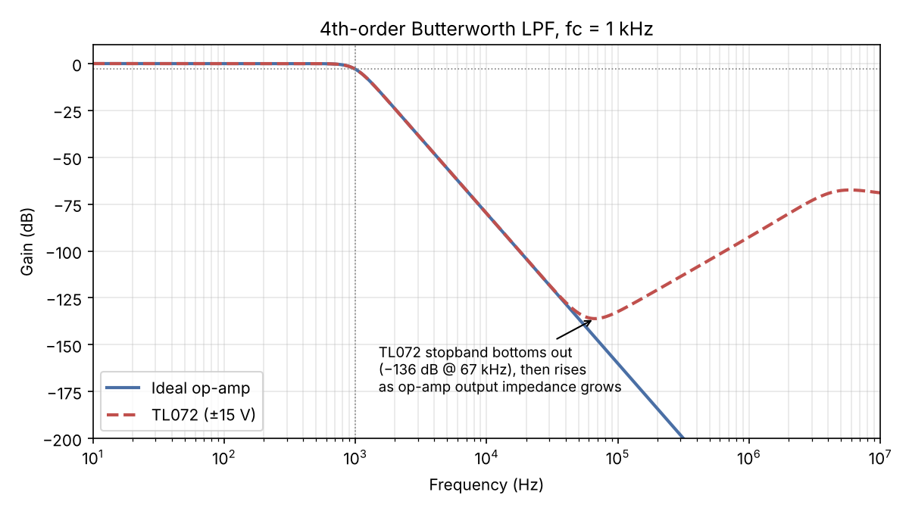
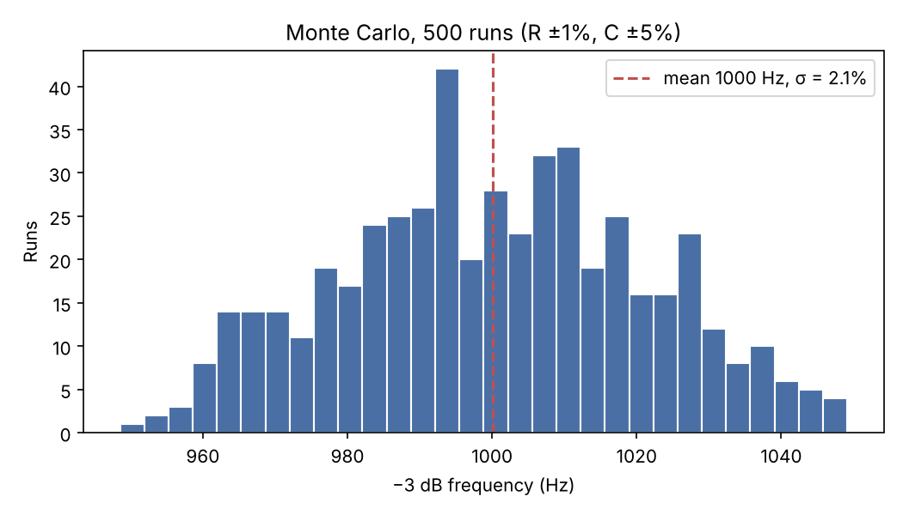

# 4th-Order Butterworth Low-Pass Active Filter (fc = 1 kHz)

Two cascaded unity-gain Sallen-Key stages, TL072 on ±15 V, E-series parts, verified against a transfer-function model, with a 500-run Monte Carlo.

## 1. Circuit

```
           Stage A (Q = 0.541)                      Stage B (Q = 1.307)
                 ┌──── CA1 15n ────┐                     ┌──── CB1 22n ────┐
                 │                 │                     │                 │
 in ──RA1 6.81k──┴──RA2 36.5k──┬──(+)UA──┬── mid ──RB1 12.1k──┴──RB2 43.2k──┬──(+)UB──┬── out
                               │   (−)───┘                                 │   (−)───┘
                             CA2 6.8n                                    CB2 2.2n
                               │                                           │
                              GND                                         GND
```
Each op-amp is a voltage follower (output tied to −input). C1 goes from the middle node to the stage output; C2 goes from +input to ground.

| Stage | Target Q | R1 | R2 | C1 (feedback) | C2 (to GND) | f0 | Q achieved |
|---|---|---|---|---|---|---|---|
| A | 0.5412 | 6.81 kΩ | 36.5 kΩ | 15 nF | 6.8 nF | 999.5 Hz | 0.5407 |
| B | 1.3066 | 12.1 kΩ | 43.2 kΩ | 22 nF | 2.2 nF | 1000.6 Hz | 1.3074 |

Resistors are E96 (1%), capacitors are E6/E12 (5%). The low-Q stage goes first so the peaking of the high-Q stage can't clip a large input.

## 2. Design equations (know these cold)

Unity-gain Sallen-Key low-pass:

- H(s) = 1 / (s²·R1R2C1C2 + s·C2(R1+R2) + 1)
- ω0 = 1/√(R1R2C1C2)
- Q = √(R1R2C1C2) / (C2(R1+R2))
- With R1 = R2, Q = ½·√(C1/C2), so you need C1/C2 ≥ 4Q². That is why stage B needs a 10:1 cap ratio.

4th-order Butterworth pole Qs: Q = 1/(2cos(π/8)) = 0.541 and 1/(2cos(3π/8)) = 1.307. Both stages sit at 1 kHz.

Method used (`python/design.py`): pick C1, C2 from E12, solve R1 + R2 = 1/(ω0·Q·C2) and R1·R2 = 1/(ω0²·C1C2), snap to E96, keep the pair with the smallest f0 + Q error.

## 3. How to reproduce

All files in `ltspice/` open directly in LTspice (File → Open → set file type to *.cir). Keep `tl072.lib` in the same folder.

1. **`1_filter_ac.cir`** (TL072). Run, then View → SPICE Error Log for the `.meas` results. Plot V(out) in dB.
2. **`2_filter_ideal.cir`** (ideal op-amp). Same steps; compare the two plots.
3. **`3_monte_carlo.cir`** (500 runs). Error Log → right-click → *Plot .step'ed .meas data*. Copy the f3db values into Excel/Python and take mean and σ.
4. **`4_follower_zout.cir`**. Shows the TL072 follower's output impedance rising ×10 per decade.
5. **`matlab/butterworth_model.m`**. Prints each stage's f0/Q and the max deviation from an ideal Butterworth.

Python + ngspice (`python/`): `design.py` picks the component values, `compare.py` checks them against the ideal Butterworth, `montecarlo.py` runs the 500-run Monte Carlo, `plots.py` makes the figures. Run `ngspice -b filter_ideal.cir` and `ngspice -b filter_tl072.cir` first to produce the AC data.

## 4. Results (ngspice, same netlists)

| Measurement | Ideal op-amp | TL072 |
|---|---|---|
| −3 dB frequency | 999.9 Hz | 999.8 Hz |
| Gain at 10 kHz | −80.0 dB | −80.0 dB |
| Gain at 100 kHz | −160 dB | −132 dB |
| Deepest stopband point | keeps falling at 80 dB/dec | −136 dB at 67 kHz |
| Gain at 1 MHz | −240 dB | −92.5 dB |
| Peak stopband leakage | n/a | ≈ −67 dB around 5 MHz |

- Chosen-value model vs ideal Butterworth: **max 0.01 dB** deviation up to 10 kHz.
- SPICE (ideal op-amp) vs transfer-function model: 0.0001 dB, so the netlist matches the math.
- Monte Carlo (500 runs, R ±1%, C ±5%, uniform): mean fc 1000.1 Hz, **σ = 21 Hz (2.1%)**, range 948 to 1049 Hz (−5.2% / +4.9%).
- TL072 model check: 107 dB open-loop gain, 3.1 MHz unity-gain frequency (datasheet: 106 dB, 3 MHz).
- TL072 follower Zout: 0.044 Ω at 1 kHz, 4.4 Ω at 100 kHz, 44 Ω at 1 MHz.




## 5. Why the TL072 stopband comes back up

At high frequency the capacitor C1 is nearly a short, so the input signal passes through R1 and C1 straight into the op-amp output node. An ideal op-amp holds that node with zero impedance. A real one holds it with Zout = Ro / (1 + Aβ), and since A falls at 20 dB/decade above a few Hz, Zout rises at the same rate. The leaked current times that rising Zout appears at the output. The response therefore stops falling around 67 kHz and climbs back, peaking near −67 dB at a few MHz where the op-amp has run out of loop gain.

Fixes worth mentioning: a passive RC pole after the filter, a faster op-amp (higher GBW keeps Zout low further out), or a multiple-feedback (MFB) topology, which doesn't have this feedforward path.

## 6. Design notes and trade-offs

- **Why Sallen-Key over MFB?** Unity gain needs no gain resistors, and Q is set by component ratios. It is non-inverting with low sensitivity to op-amp gain. Downside: the high-frequency feedthrough above. MFB is inverting and has better stopband.
- **Why put the low-Q stage first?** The high-Q stage peaks internally. Placing it last keeps the earlier stage from clipping on large inputs. (Noise arguments can go either way.)
- **What sets Q in a unity-gain Sallen-Key?** The capacitor ratio, Q = ½√(C1/C2) with equal resistors.
- **Which parts dominate fc spread?** The 5% capacitors. fc ∝ 1/√(R1R2C1C2), so each part's error contributes about half its percentage. Four 5% caps dominate four 1% resistors.
- **How much op-amp GBW is needed?** Rule of thumb GBW ≥ 100·Q·f0 for a stage. For stage B that is ~130 kHz. The TL072's 3 MHz is plenty in the passband.
- **What would you change for a real board?** C0G/NP0 capacitors (low drift, low distortion), 1% metal-film resistors, supply decoupling, and an RC post-filter if the stopband above 100 kHz matters.
